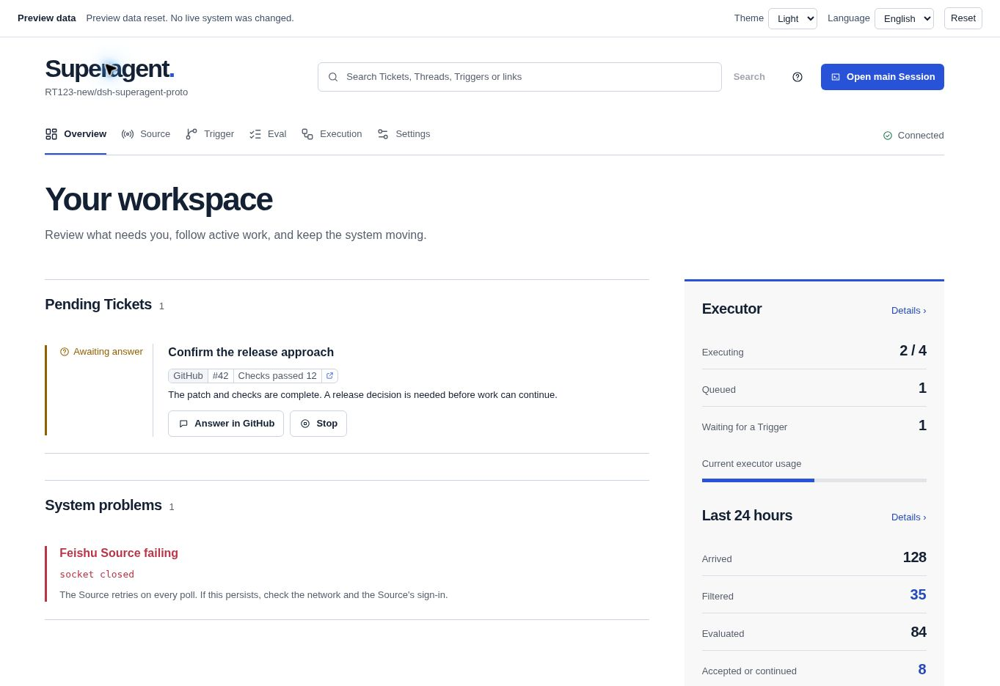
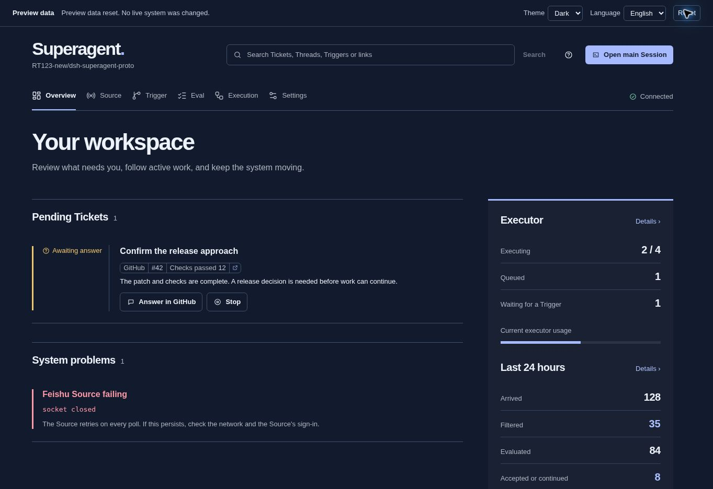
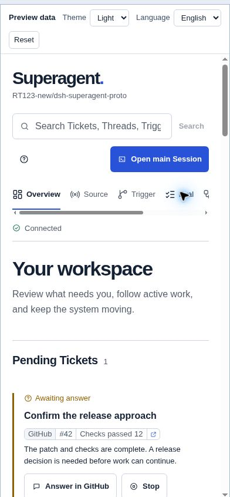
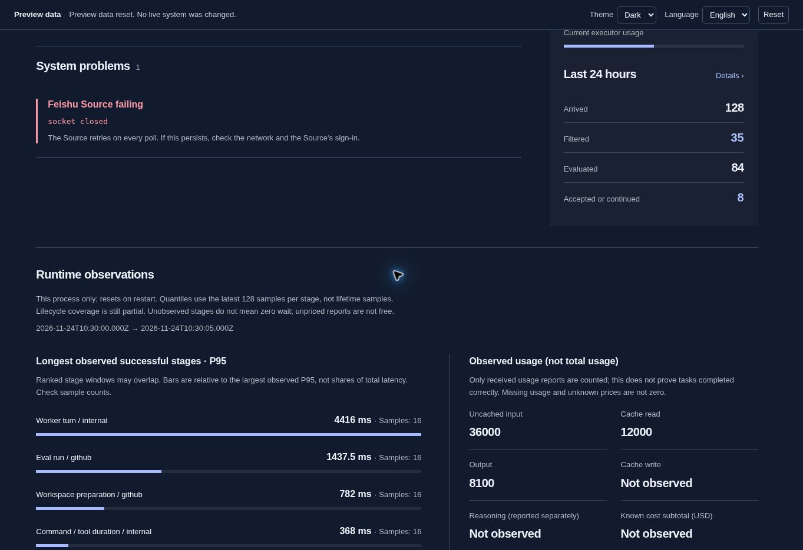

# Superagent workspace redesign

24 November 2026. Baseline: `f68f117343758c9e3c94bab30f0a5a0feedb0305`.

## What changed

The requested [Gemini frontend-design skill](https://github.com/google-gemini/demolab/tree/main/skills/gemini-frontend-design) was applied to the actual React application. The direction is an open operations workspace: a strong wordmark, compact underlined navigation, large route headings, open task rows and a narrower operational context column. The previous rounded card grid, decorative header label and connection badge have been replaced.

Pending questions and system problems remain first in document order. Executor capacity and recent activity sit alongside them on wide screens and follow them on narrow screens. Latency ranking and observed usage share a performance section; complete successful and failed measurements remain available in an open disclosure, with process diagnostics in a separate disclosure.

Shared controls, settings, forms, task details and dialogs use the same typography, spacing and host theme tokens. Body text uses a 13/16/20 px scale; the wordmark and primary headings are separate. English and Chinese labels, unknown measurements, sample counts, failure data, coverage notes, polling, confirmation targets and existing actions are retained. There are no new runtime dependencies or backend/API changes.

The design intent is to make the next required action easier to find. That usability hypothesis has not been measured with users; the evidence below establishes rendering and regression behavior, not faster task completion.

## Validation

`pnpm check` passed locally: typecheck, **155 test files / 1,857 tests passed / 2 existing opt-in tests skipped**, and the production build. The test suite took 43.11 seconds. A separate preview fixture export test passed. Focused tests overlap the full suite and are not counted as additional independent evidence. The three edited test files change only intended layout order, a scoped Details selection and the detail page's heading level; behavioral assertions remain.

Browser inspection used the actual `App` component tree and actual stylesheet, with labelled, disposable sample data. Desktop was inspected at 1440 × 1000 in light and dark themes; mobile at 390 × 844 in English and Chinese; tablet search/settings at 768 × 1024. Final standalone desktop captures use a 1348 px content width. This is a real frontend preview with approximate host theme variables, not installation into DSH.

| Check | Result |
| --- | --- |
| Desktop and mobile page overflow | Page `scrollWidth` equalled `clientWidth` in the inspected states. |
| Body type scale | Observed 13, 16 and 20 px; no sub-13 px body text in the inspected overview. |
| All six main routes and task details | Rendered with real components and representative fixture responses. |
| Tablet search | Corrected clipping: left edge changed from −73.20 px to 34.55 px; right edge 594.55 px inside the 768 px viewport. |
| Unsaved settings | Corrected the old negative margin; savebar edges now match the form. Discard restored the original value. |
| Mobile confirmation | 342 px wide, within x=24…366; 16 px explanation text. Escape closed it and restored focus to Stop. |
| Keyboard tabs | Home selected and focused Overview; only the selected main tab remained a tab stop. |
| Mobile metric tables | Keyboard horizontal scrolling worked inside the table region without widening the page. |
| Empty state | Confirming Stop against disposable data removed the pending item and displayed the explanatory empty state. |
| Console | No application-origin errors in the inspected console entries; browser-extension metadata errors were separate. |

The detailed measurements are in [verification.json](verification.json). Browser inspection found and resolved the tablet dropdown clipping, savebar protrusion, brand accessible-name mismatch and absent detail-level primary heading. Preview inspection additionally caught incomplete host colour tokens and an impossible queued fixture state; both were corrected. The queued fixture now uses the production `working` / `queued` state with a pending, unstarted assignment.

## Preview and screenshots

The rebuild instructions and the preview's supported behavior are in [scripts/ui-preview/README.md](../../scripts/ui-preview/README.md). Baseline and candidate HTML builds use the same corrected fixture. The screenshots below show the candidate; they are not an automated pixel-diff assertion. Synthetic counts and timings are not operational or performance evidence.

## What remains unproven

Installed-host appearance, native Session navigation, the deployment form service, authentication and live provider connectivity require an installed DSH check. This was not an exhaustive accessibility audit or a test of every viewport/theme combination. The shared preview route interrupted the attempted dark mobile capture; that combination is not claimed as passed. The final standalone preview was restored and inspected.

The earlier reproduced delivery-settlement persistence defect and originating-turn attribution gap remain unchanged. A UI redesign does not close those backend findings or establish live model efficacy, spend enforcement or process containment.

The next useful acceptance check is one installed-host walkthrough against the old UI: find a pending question, open it, cancel a stop confirmation, locate a queued ticket, search for a thread, edit and discard a setting, and read an unobserved metric. Success means every action remains reachable by keyboard and at mobile width, displayed state matches the host, and no unknown measurement is presented as zero. Timing the same tasks in both designs would test the usability hypothesis.

## Review disposition

Publish as an isolated draft on `fix/gemini-workspace-ui-20261124`, based on `fix/third-pass-integration-20261124`. The `fix/**` push filter runs both repository CI jobs (`check` and `stage-d`); bind their reported results to the exact new commit. Keep the existing fixes and this visual change separately reviewable. No merge or production deployment is part of this change.
